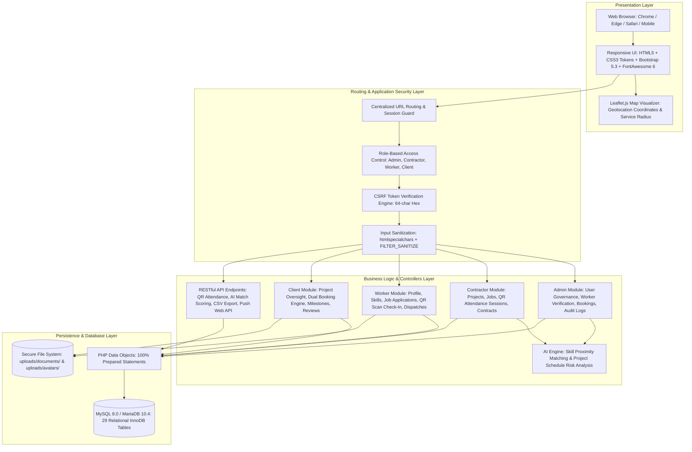
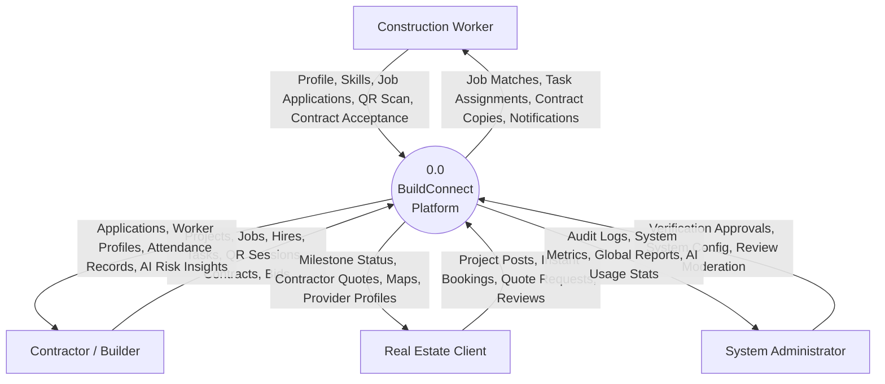

# BuildConnect — System Architecture & Design

## 1. System Architecture Overview

BuildConnect is architected as an enterprise-grade **Three-Tier (Layered) Web Architecture** designed for high throughput, modular maintainability, and strict security isolation. The application cleanly decouples the Presentation Layer, the Application / Business Logic Layer, and the Data Persistence Layer.

---

## 2. Layer Decomposition

### 2.1 Presentation Layer (Client Tier)
* **HTML5 Semantic Structure**: Clean semantic hierarchy (`<header>`, `<nav>`, `<main>`, `<section>`, `<footer>`) ensuring accessibility, predictability, and SEO optimization.
* **Custom CSS Design System**: Centralized color variables (`--bc-navy: #0B132B`, `--bc-amber: #FFAA16`, `--bc-card: #111C2D`) delivering an industrial dark-and-gold visual aesthetic.
* **Bootstrap 5.3 Grid**: Flexible responsive grid system supporting standard viewports from mobile (`col-12`) to desktop (`col-lg-4`, `col-xl-3`).
* **Leaflet.js Geospatial Mapping**: Client-side interactive mapping rendering OpenStreetMap tiles, site pins, worker proximity circles, and coordinates.

### 2.2 Application & Business Logic Layer (Middle Tier)
* **Modular Role Controllers**: Dispatched into discrete directory hierarchies (`admin/`, `contractor/`, `worker/`, `client/`, `api/`) ensuring single-responsibility encapsulation.
* **Central Authentication & RBAC (`includes/auth.php`)**: Validates active session state on every page load (`require_login()`) and restricts execution to permitted roles (`require_role(...)`).
* **Dual Booking Core (`includes/booking-functions.php`)**: Implements the state machine for Instant Bookings (Mode A) and Competitive Quotes (Mode B), including the Haversine distance calculator and atomic row locking (`FOR UPDATE`).
* **AI Matching Engine (`includes/ai.php`)**: Evaluates multi-factor candidate suitability (trade titles, skills, experience, ratings, proximity) to compute normalized match scores (0–100%).
* **RESTful JSON Endpoints (`api/`)**: Provides lightweight, stateless controllers for AJAX requests, QR attendance logging, and CSV exports.

### 2.3 Data Persistence Layer (Database Tier)
* **PHP Data Objects (PDO)**: Standardized database abstraction layer configured with `PDO::ERRMODE_EXCEPTION`, `PDO::ATTR_DEFAULT_FETCH_MODE => PDO::FETCH_ASSOC`, and disabled emulated prepares.
* **MySQL 8.0 InnoDB Engine**: Houses 29 normalized relational tables enforcing referential integrity (`ON DELETE CASCADE` / `ON DELETE RESTRICT`), foreign keys, and indexes.
* **Storage Sandbox (`uploads/`)**: Segregated file system storage storing user avatars and identity verification documents, protected by MIME inspection and executable execution blocking.

---

## 3. Use Case Analysis

### 3.1 Global Use Case Diagram
The diagram below illustrates the interactions between the four primary actors and the platform's core functional subsystems:

```mermaid
graph LR
    %% Actors
    Admin((System Administrator))
    Contractor((Contractor / Builder))
    Worker((Construction Worker))
    Client((Real Estate Client))

    %% Admin Subgraph
    subgraph AdminActions [Admin Governance]
        UC_A1[Manage Users & Account Status]
        UC_A2[Verify Worker ID & Trade Documents]
        UC_A3[Oversee All Projects & Jobs]
        UC_A4[Moderate Reviews & Disputes]
        UC_A5[Monitor Security Audit Logs & AI Usage]
        UC_A6[Inspect Service Bookings & Quotes]
    end

    %% Contractor Subgraph
    subgraph ContractorActions [Contractor Portfolio & Workforce]
        UC_C1[Create Construction Projects & Milestones]
        UC_C2[Post Trade Job Listings]
        UC_C3[Review Applications & Hire Workers]
        UC_C4[Assign Daily Work Tasks]
        UC_C5[Generate Dynamic QR Attendance Sessions]
        UC_C6[Issue Binding Digital Contracts]
        UC_C7[Submit Quotes for Client Construction Requests]
        UC_C8[Run AI Worker Matching & Project Risk Analysis]
    end

    %% Worker Subgraph
    subgraph WorkerActions [Worker Professional Lifecycle]
        UC_W1[Maintain Trade Skills & Document Portfolio]
        UC_W2[Browse Jobs & Submit Applications]
        UC_W3[Scan QR Code Site Attendance Check-In/Out]
        UC_W4[Review & Sign Digital Contracts Electronically]
        UC_W5[Receive & Accept/Reject Instant Bookings]
        UC_W6[Update Assigned Task Progress]
        UC_W7[View Earnings & Work History]
    end

    %% Client Subgraph
    subgraph ClientActions [Client Project & Service Booking]
        UC_CL1[Post Large Projects for Contractor Quotes]
        UC_CL2[Book Instant Emergency Repairs Mode A]
        UC_CL3[Compare Multi-Contractor Bids Mode B]
        UC_CL4[Monitor Milestone Progress & Site Coordinates]
        UC_CL5[Review Project Documents & Blueprints]
        UC_CL6[Submit Two-Way Star Ratings & Reviews]
    end

    %% Connectors
    Admin --> UC_A1
    Admin --> UC_A2
    Admin --> UC_A3
    Admin --> UC_A4
    Admin --> UC_A5
    Admin --> UC_A6

    Contractor --> UC_C1
    Contractor --> UC_C2
    Contractor --> UC_C3
    Contractor --> UC_C4
    Contractor --> UC_C5
    Contractor --> UC_C6
    Contractor --> UC_C7
    Contractor --> UC_C8

    Worker --> UC_W1
    Worker --> UC_W2
    Worker --> UC_W3
    Worker --> UC_W4
    Worker --> UC_W5
    Worker --> UC_W6
    Worker --> UC_W7

    Client --> UC_CL1
    Client --> UC_CL2
    Client --> UC_CL3
    Client --> UC_CL4
    Client --> UC_CL5
    Client --> UC_CL6
```

### 3.2 Detailed Actor Use Case Descriptions

#### Administrator Actor
* **UC-A1: Manage Users**: Administrator browses, searches, edits, activates, or suspends user accounts across all roles.
* **UC-A2: Verify Worker Documents**: Administrator inspects uploaded government identity documents and trade licenses, either granting `approved` verification badge or rejecting with notes.
* **UC-A5: Audit Log Monitoring**: Administrator reviews system-wide immutable activity logs capturing IP addresses, actions, entity IDs, and timestamps.

#### Contractor Actor
* **UC-C1: Project & Milestone Management**: Contractor establishes projects with geographic coordinates, budgets, and defines milestones with completion percentages.
* **UC-C3: Workforce Hiring**: Contractor inspects candidate profiles, reviews AI match scores, and hires candidates, automatically adding them to `project_members`.
* **UC-C5: QR Attendance Session**: Contractor generates dynamic, tokenized QR codes on site for daily worker check-ins.

#### Worker Actor
* **UC-W2: Job Applications**: Worker browses open jobs, reviews pay rates, and applies with customized cover notes and expected daily wages.
* **UC-W3: QR Attendance Check-In**: Worker scans the site QR code or inputs the session token to log an authenticated, timestamped attendance record.
* **UC-W5: Instant Booking Dispatch**: Worker receives immediate job dispatch requests within their proximity radius and confirms or rejects.

#### Client Actor
* **UC-CL2: Instant Booking (Mode A)**: Client enters emergency repair details (category, urgency, location, budget); system identifies and dispatches nearby qualified workers.
* **UC-CL3: Compare Quotes (Mode B)**: Client posts scope for major renovations; receives itemized bids from verified providers, compares prices, and accepts the winning bid.
* **UC-CL6: Two-Way Review Submission**: Client rates completed service provider from 1 to 5 stars with qualitative feedback, updating cumulative provider ratings.

---

## 4. Data Flow Diagrams (DFD)

### 4.1 DFD Level 0 (Context-Level Diagram)
The Context-Level DFD models the boundaries of the BuildConnect system, showing the major information flows between external entities and the centralized system process:

---

### 4.2 DFD Level 1 (Subsystem Decomposition Diagram)
The Level 1 DFD decomposes the system into seven primary functional processes and their associated persistent relational data stores:

```mermaid
graph TD
    %% Entities
    Worker[Worker]
    Contractor[Contractor]
    Client[Client]
    Admin[Admin]

    %% Data Stores
    D1[(D1: Users & Profiles)]
    D2[(D2: Projects & Milestones)]
    D3[(D3: Jobs & Applications)]
    D4[(D4: Attendance & Sessions)]
    D5[(D5: Contracts & Payments)]
    D6[(D6: Dual Bookings & Quotes)]
    D7[(D7: Reviews & Activity Logs)]

    %% Processes
    P1((1.0<br/>Authentication<br/>& Governance))
    P2((2.0<br/>Project & Task<br/>Management))
    P3((3.0<br/>Job Marketplace<br/>& Hiring))
    P4((4.0<br/>QR Attendance<br/>Tracking))
    P5((5.0<br/>Digital Contract<br/>Lifecycle))
    P6((6.0<br/>Dual Booking<br/>Engine))
    P7((7.0<br/>Feedback & Audit<br/>Logging))

    %% Data Flows
    Worker -->|Registration & Skills| P1
    Contractor -->|Company Profile| P1
    Client -->|Account Data| P1
    Admin -->|Verify Documents| P1
    P1 <--> D1

    Contractor -->|Create Project & Milestones| P2
    Client -->|View Milestone Progress| P2
    P2 <--> D2

    Contractor -->|Post Job| P3
    Worker -->|Apply for Job| P3
    Contractor -->|Hire Applicant| P3
    P3 <--> D3

    Contractor -->|Generate QR Session| P4
    Worker -->|Scan QR Check-In/Out| P4
    P4 <--> D4

    Contractor -->|Issue Contract| P5
    Worker -->|Sign Contract| P5
    P5 <--> D5

    Client -->|Instant Booking / Quote Request| P6
    Worker -->|Accept Instant Booking| P6
    Contractor -->|Submit Competitive Quote| P6
    Client -->|Select Winning Quote| P6
    P6 <--> D6

    Client -->|Rate Provider| P7
    Contractor -->|Review Worker| P7
    Admin -->|Inspect Audit Logs| P7
    P7 <--> D7
```

