# BuildConnect — Database Design & Data Dictionary

## 1. Database Architecture Overview

BuildConnect is backed by a relational schema implemented in **MySQL 8.0 / MariaDB 10.4** using the **InnoDB** storage engine. The database enforces strict referential integrity through foreign key constraints, composite performance indexes, and full UTF-8 Unicode character support (`utf8mb4_unicode_ci`).

The database comprises exactly **29 relational tables** organized into six functional domain clusters:
1. **Identity & User Profiles**: `users`, `workers`, `contractors`, `clients`
2. **Trade Skills & Credentials**: `skills`, `worker_skills`, `worker_experience`, `worker_documents`
3. **Projects, Milestones & Tasks**: `projects`, `project_members`, `milestones`, `tasks`, `project_documents`
4. **Job Marketplace & Hiring**: `jobs`, `job_applications`
5. **Site Operations, Contracts & Payments**: `attendance_sessions`, `attendance`, `contracts`, `payments`
6. **Dual Booking, Communication & Governance**: `bookings`, `booking_quotes`, `reviews`, `review_reports`, `notifications`, `messages`, `push_subscriptions`, `activity_logs`, `ai_match_results`, `ai_usage_logs`

---

## 2. Entity Relationship Diagram (ERD)

```mermaid
erDiagram
    users ||--o| workers : "has profile"
    users ||--o| contractors : "has profile"
    users ||--o| clients : "has profile"
    users ||--o{ projects : "creates/owns"
    users ||--o{ jobs : "posts"
    users ||--o{ job_applications : "applies"
    users ||--o{ attendance : "logs attendance"
    users ||--o{ contracts : "signs contract"
    users ||--o{ reviews : "authors/receives"
    users ||--o{ notifications : "receives"
    users ||--o{ activity_logs : "triggers"
    users ||--o{ bookings : "client/provider"
    users ||--o{ booking_quotes : "submits quote"

    workers ||--o{ worker_skills : "has skill"
    skills ||--o{ worker_skills : "mapped to"
    workers ||--o{ worker_experience : "has experience"
    workers ||--o{ worker_documents : "uploads"

    projects ||--o{ milestones : "contains"
    projects ||--o{ tasks : "divided into"
    projects ||--o{ project_members : "enrolls"
    projects ||--o{ project_documents : "stores"
    projects ||--o{ attendance_sessions : "hosts session"
    projects ||--o{ attendance : "tracks on site"
    projects ||--o{ jobs : "originates"
    projects ||--o{ contracts : "formalizes"
    projects ||--o{ payments : "disburses"

    attendance_sessions ||--o{ attendance : "verifies"
    jobs ||--o{ job_applications : "receives"
    jobs ||--o{ ai_match_results : "evaluated by"
    contracts ||--o{ payments : "pays"
    contracts ||--o{ reviews : "assesses"

    bookings ||--o{ booking_quotes : "collects quotes"

    users {
        int id PK
        string name
        string email UK
        string password
        string role
        string phone
        string status
    }

    workers {
        int id PK
        int user_id FK
        string trade_title
        int experience_years
        decimal daily_rate
        decimal location_lat
        decimal location_lng
        string verification_status
        decimal rating_avg
    }

    contractors {
        int id PK
        int user_id FK
        string company_name
        string license_no
        string city
        decimal rating_avg
    }

    clients {
        int id PK
        int user_id FK
        string company_name
        string client_type
        string city
    }

    projects {
        int id PK
        int contractor_id FK
        int client_id FK
        string title
        string location
        decimal location_lat
        decimal location_lng
        decimal budget
        string status
        int progress_percent
        string qr_code_token UK
    }

    jobs {
        int id PK
        int project_id FK
        int contractor_id FK
        string title
        string trade_required
        decimal pay_rate
        string status
    }

    job_applications {
        int id PK
        int job_id FK
        int worker_id FK
        int match_score
        string status
    }

    attendance {
        int id PK
        int project_id FK
        int worker_id FK
        date attendance_date
        datetime check_in_time
        datetime check_out_time
        tinyint verified_by_qr
        string status
    }

    contracts {
        int id PK
        int project_id FK
        int contractor_id FK
        int worker_id FK
        string contract_number UK
        decimal payment_amount
        string status
    }

    bookings {
        int id PK
        string booking_number UK
        int client_id FK
        int provider_id FK
        string booking_mode
        string category
        string title
        decimal location_lat
        decimal location_lng
        decimal price
        string status
    }

    booking_quotes {
        int id PK
        int booking_id FK
        int provider_id FK
        string provider_role
        decimal proposed_price
        string estimated_duration
        string status
    }
```

---

## 3. Comprehensive Data Dictionary (29 Tables)

### 3.1 `users`
*Purpose: Master authentication accounts and core user profile data.*
| Column | Type | Nullable | Default | Key | Description / Relationships |
| :--- | :--- | :---: | :--- | :---: | :--- |
| `id` | `int(11)` | NO | Auto Increment | PRI | Primary Key |
| `name` | `varchar(100)` | NO | None | | User full name |
| `email` | `varchar(150)` | NO | None | UNI | Unique login email address |
| `password` | `varchar(255)` | NO | None | | Bcrypt password hash |
| `role` | `enum('admin','contractor','worker','client')` | NO | None | MUL | Account role governing RBAC |
| `phone` | `varchar(30)` | YES | NULL | | Contact telephone number |
| `avatar` | `varchar(255)` | YES | `'default_avatar.png'` | | Avatar image filename |
| `status` | `enum('active','inactive','suspended')` | YES | `'active'` | | Account operational status |
| `created_at` | `timestamp` | NO | `current_timestamp()` | | Registration timestamp |
| `updated_at` | `timestamp` | NO | `current_timestamp()` | | Last modification timestamp |

---

### 3.2 `workers`
*Purpose: Professional trade credentials and profile parameters for construction workers.*
| Column | Type | Nullable | Default | Key | Description / Relationships |
| :--- | :--- | :---: | :--- | :---: | :--- |
| `id` | `int(11)` | NO | Auto Increment | PRI | Primary Key |
| `user_id` | `int(11)` | NO | None | UNI | Foreign Key -> `users(id)` |
| `trade_title` | `varchar(100)` | YES | `'General Construction Specialist'` | | Primary trade title |
| `experience_years` | `int(11)` | YES | `0` | | Years of professional trade experience |
| `hourly_rate` | `decimal(10,2)` | YES | `35.00` | | Base hourly billing rate in INR |
| `daily_rate` | `decimal(10,2)` | YES | `280.00` | | Standard daily wage rate in INR |
| `bio` | `text` | YES | NULL | | Professional summary |
| `city` | `varchar(100)` | YES | `'Ahmedabad'` | | Operating city |
| `state` | `varchar(100)` | YES | NULL | | Operating state |
| `address` | `text` | YES | NULL | | Physical address |
| `location_lat` | `decimal(10,7)`| YES | `23.0225000` | | Latitude coordinate |
| `location_lng` | `decimal(10,7)`| YES | `72.5714000` | | Longitude coordinate |
| `service_radius_km` | `int(11)` | YES | `10` | | Service availability radius in km |
| `availability_status` | `enum('available','partially_available','not_available')` | YES | `'available'` | | Current dispatch availability |
| `preferred_work_type` | `varchar(100)` | YES | `'Full-Time'` | | Work type preference |
| `preferred_location` | `varchar(150)` | YES | NULL | | Location preference |
| `available_from_date` | `date` | YES | NULL | | Earliest available start date |
| `verification_status` | `enum('pending','approved','rejected')` | YES | `'pending'` | MUL | ID verification state |
| `verified_at` | `datetime` | YES | NULL | | Verification approval timestamp |
| `verified_by_user_id`| `int(11)` | YES | NULL | MUL | Foreign Key -> `users(id)` (Admin) |
| `rating_avg` | `decimal(3,2)` | YES | `5.00` | | Cumulative star rating (1.00–5.00) |
| `reviews_count` | `int(11)` | YES | `0` | | Total number of received reviews |
| `created_at` | `timestamp` | NO | `current_timestamp()` | | Profile creation timestamp |
| `updated_at` | `timestamp` | NO | `current_timestamp()` | | Last update timestamp |

---

### 3.3 `contractors`
*Purpose: Corporate profile and trade license data for contractors.*
| Column | Type | Nullable | Default | Key | Description / Relationships |
| :--- | :--- | :---: | :--- | :---: | :--- |
| `id` | `int(11)` | NO | Auto Increment | PRI | Primary Key |
| `user_id` | `int(11)` | NO | None | UNI | Foreign Key -> `users(id)` |
| `company_name` | `varchar(150)` | NO | None | | Registered contracting business name |
| `license_no` | `varchar(100)` | YES | NULL | | State contractor trade license number |
| `company_address`| `text` | YES | NULL | | Corporate headquarters address |
| `company_description`| `text` | YES | NULL | | Contracting capabilities description |
| `city` | `varchar(100)` | YES | NULL | | Corporate headquarters city |
| `state` | `varchar(100)` | YES | NULL | | Corporate headquarters state |
| `website` | `varchar(255)` | YES | NULL | | Official business website |
| `rating_avg` | `decimal(3,2)` | YES | `5.00` | | Cumulative star rating |
| `created_at` | `timestamp` | NO | `current_timestamp()` | | Profile creation timestamp |
| `updated_at` | `timestamp` | NO | `current_timestamp()` | | Last profile update timestamp |

---

### 3.4 `clients`
*Purpose: Profile records for real estate developers and property owners.*
| Column | Type | Nullable | Default | Key | Description / Relationships |
| :--- | :--- | :---: | :--- | :---: | :--- |
| `id` | `int(11)` | NO | Auto Increment | PRI | Primary Key |
| `user_id` | `int(11)` | NO | None | UNI | Foreign Key -> `users(id)` |
| `company_name` | `varchar(150)` | YES | NULL | | Client company or individual name |
| `client_type` | `varchar(50)` | YES | `'Commercial Developer'`| | Developer classification |
| `address` | `text` | YES | NULL | | Client mailing address |
| `city` | `varchar(100)` | YES | NULL | | Operating city |
| `state` | `varchar(100)` | YES | NULL | | Operating state |
| `created_at` | `timestamp` | NO | `current_timestamp()` | | Profile creation timestamp |
| `updated_at` | `timestamp` | NO | `current_timestamp()` | | Last profile update timestamp |

---

### 3.5 `skills` & `worker_skills`
*Purpose: Canonical trade skill dictionary and worker proficiency mappings.*
* **`skills`**: `id` (PK), `name` (varchar 100, UNI), `category` (varchar 50), `created_at`.
* **`worker_skills`**: `id` (PK), `worker_id` (FK -> `workers.id`), `skill_id` (FK -> `skills.id`), `proficiency_level` (`enum('beginner','intermediate','advanced','expert')`), `created_at`.

---

### 3.6 `worker_documents` & `worker_experience`
*Purpose: Identity credential attachments and verified past employment records.*
* **`worker_documents`**: `id` (PK), `worker_id` (FK -> `workers.id`), `document_type` (varchar 50), `document_number` (varchar 100), `file_path` (varchar 255), `file_name` (varchar 150), `issue_date` (date), `expiry_date` (date), `status` (`enum('pending','approved','rejected')`), `created_at`.
* **`worker_experience`**: `id` (PK), `worker_id` (FK -> `workers.id`), `job_title` (varchar 150), `company_name` (varchar 150), `description` (text), `start_date` (date), `end_date` (date), `is_current` (tinyint), `created_at`, `updated_at`.

---

### 3.7 `projects`
*Purpose: Core construction project records, geolocations, and progress tracking.*
| Column | Type | Nullable | Default | Key | Description / Relationships |
| :--- | :--- | :---: | :--- | :---: | :--- |
| `id` | `int(11)` | NO | Auto Increment | PRI | Primary Key |
| `contractor_id` | `int(11)` | NO | None | MUL | Foreign Key -> `users(id)` (Contractor) |
| `client_id` | `int(11)` | YES | NULL | MUL | Foreign Key -> `users(id)` (Client) |
| `title` | `varchar(150)` | NO | None | | Project title |
| `description` | `text` | YES | NULL | | Detailed scope and specifications |
| `location` | `varchar(200)` | NO | None | | Descriptive location |
| `address` | `varchar(255)` | YES | NULL | | Physical street address |
| `city` | `varchar(100)` | YES | `'Ahmedabad'` | MUL | Project city |
| `state` | `varchar(100)` | YES | `'Gujarat'` | MUL | Project state |
| `postal_code` | `varchar(20)` | YES | `'380054'` | | Postal PIN code |
| `location_lat` | `decimal(10,7)`| YES | `23.0225000` | MUL | Geolocation latitude |
| `location_lng` | `decimal(10,7)`| YES | `72.5714000` | | Geolocation longitude |
| `budget` | `decimal(12,2)`| NO | None | | Total allocated budget in INR |
| `start_date` | `date` | YES | NULL | | Project commencement date |
| `end_date` | `date` | YES | NULL | | Target completion date |
| `status` | `enum('pending','planning','active','in_progress','on_hold','completed','cancelled')` | YES | `'in_progress'` | MUL | Project lifecycle state |
| `progress_percent`| `int(11)` | YES | `0` | | Overall completion (0–100%) |
| `qr_code_token` | `varchar(64)` | YES | NULL | UNI | Project site QR master token |
| `created_at` | `timestamp` | NO | `current_timestamp()` | | Creation timestamp |
| `updated_at` | `timestamp` | NO | `current_timestamp()` | | Last update timestamp |

---

### 3.8 `project_members`, `milestones`, `tasks`, `project_documents`
*Purpose: Subsystems governing project workforce, scheduled phases, daily tasks, and blueprints.*
* **`project_members`**: `id` (PK), `project_id` (FK -> `projects.id`), `user_id` (FK -> `users.id`), `role_in_project` (varchar 50), `status` (`enum('active','removed','completed')`), `joined_at`.
* **`milestones`**: `id` (PK), `project_id` (FK -> `projects.id`), `title` (varchar 150), `description` (text), `target_date` (date), `amount` (decimal 10,2), `progress_percent` (int 11), `status` (`enum('pending','in_progress','completed','delayed')`), `completed_at` (datetime), `created_at`, `updated_at`.
* **`tasks`**: `id` (PK), `project_id` (FK -> `projects.id`), `milestone_id` (FK -> `milestones.id`), `title` (varchar 150), `description` (text), `assigned_to_worker_id` (FK -> `users.id`), `priority` (`enum('low','medium','high','urgent','critical')`), `status` (`enum('pending','todo','in_progress','review','blocked','done','completed','cancelled')`), `progress_percent` (int), `start_date`, `due_date`, `completed_at`, `created_at`, `updated_at`.
* **`project_documents`**: `id` (PK), `project_id` (FK -> `projects.id`), `uploaded_by_user_id` (FK -> `users.id`), `title` (varchar 150), `file_path` (varchar 255), `file_type` (varchar 50), `created_at`.

---

### 3.9 `jobs` & `job_applications`
*Purpose: Construction job marketplace and candidate recruitment lifecycle.*
* **`jobs`**: `id` (PK), `project_id` (FK -> `projects.id`), `contractor_id` (FK -> `users.id`), `title` (varchar 150), `trade_required` (varchar 100), `description` (text), `pay_rate` (decimal 10,2), `pay_type` (`enum('hourly','daily','fixed')`), `location` (varchar 200), `city`, `state`, `employment_type`, `start_date`, `end_date`, `spots_available` (int), `spots_filled` (int), `status` (`enum('draft','published','open','paused','closed','filled','cancelled')`), `created_at`, `updated_at`.
* **`job_applications`**: `id` (PK), `job_id` (FK -> `jobs.id`), `worker_id` (FK -> `users.id`), `match_score` (int, default 85), `cover_note` (text), `expected_pay` (decimal 10,2), `status` (`enum('pending','shortlisted','accepted','rejected','withdrawn')`), `applied_at`, `updated_at`.

---

### 3.10 `attendance_sessions` & `attendance`
*Purpose: Dynamic tokenized QR sessions and daily worker attendance tracking.*
* **`attendance_sessions`**: `id` (PK), `project_id` (FK -> `projects.id`), `created_by` (FK -> `users.id`), `token` (varchar 64, UNI), `expires_at` (datetime), `status` (`enum('active','expired','closed')`), `created_at`.
* **`attendance`**: `id` (PK), `project_id` (FK -> `projects.id`), `worker_id` (FK -> `users.id`), `attendance_date` (date), `check_in_time` (datetime), `check_out_time` (datetime), `location_lat` (decimal 10,7), `location_lng` (decimal 10,7), `hours_worked` (decimal 5,2), `verified_by_qr` (tinyint), `qr_session_id` (FK -> `attendance_sessions.id`), `status` (`enum('present','late','half_day','absent','incomplete')`), `created_at`, `updated_at`.

---

### 3.11 `contracts` & `payments`
*Purpose: Formal digital agreements, electronic signatures, and milestone disbursement logs.*
* **`contracts`**: `id` (PK), `project_id` (FK -> `projects.id`), `job_id` (FK -> `jobs.id`), `job_application_id` (int), `contractor_id` (FK -> `users.id`), `worker_id` (FK -> `users.id`), `contract_number` (varchar 50, UNI), `title` (varchar 150), `description` (text), `terms` (text), `payment_type` (`enum('hourly','daily','fixed')`), `payment_amount` (decimal 10,2), `pay_amount` (decimal 10,2), `working_hours` (varchar 100), `start_date` (date), `end_date` (date), `contractor_signature` (text), `worker_signature` (text), `contractor_signed_at` (datetime), `worker_signed_at` (datetime), `rejection_reason` (text), `status` (`enum('draft','pending','active','completed','cancelled','rejected','expired')`), `created_at`, `updated_at`, `signed_at`.
* **`payments`**: `id` (PK), `contract_id` (int), `project_id` (FK -> `projects.id`), `payer_id` (int), `payee_id` (int), `amount` (decimal 10,2), `payment_method` (varchar 50), `status` (`enum('pending','completed','failed')`), `paid_at`.

---

### 3.12 `bookings` & `booking_quotes` (Dual Booking Engine)
*Purpose: Manages Mode A (Instant Booking) and Mode B (Compare Quotes) service workflows.*
* **`bookings`**: `id` (PK), `booking_number` (varchar 50, UNI), `client_id` (FK -> `users.id`), `provider_id` (FK -> `users.id`), `provider_type` (`enum('worker','contractor')`), `booking_mode` (`enum('instant','quote')`), `category` (varchar 100), `title` (varchar 150), `description` (text), `address` (varchar 255), `city` (varchar 100), `state` (varchar 100), `location_lat` (decimal 10,7), `location_lng` (decimal 10,7), `matching_radius_km` (int), `preferred_date` (date), `preferred_time` (varchar 50), `urgency` (`enum('low','medium','high','urgent')`), `price` (decimal 10,2), `budget_min` (decimal 10,2), `budget_max` (decimal 10,2), `duration_estimate` (varchar 100), `materials_included` (tinyint), `special_requirements` (text), `photos_json` (text), `status` (`enum('draft','posted','matching','quotes_received','accepted','confirmed','on_the_way','work_started','completed','cancelled','expired','disputed')`), `cancellation_reason` (text), `cancelled_by` (int), `accepted_at`, `started_at`, `completed_at`, `created_at`, `updated_at`.
* **`booking_quotes`**: `id` (PK), `booking_id` (FK -> `bookings.id`), `provider_id` (FK -> `users.id`), `provider_role` (`enum('worker','contractor')`), `proposed_price` (decimal 10,2), `scope_of_work` (text), `exclusions` (text), `estimated_duration` (varchar 100), `proposed_start_date` (date), `materials_included` (`enum('included','excluded','labor_only')`), `valid_until` (date), `notes` (text), `status` (`enum('submitted','revised','accepted','rejected','withdrawn','expired')`), `created_at`, `updated_at`.

---

### 3.13 `reviews`, `review_reports`, `notifications`, `messages`, `push_subscriptions`
*Purpose: Two-way feedback, moderation, alert notifications, and web push subscriptions.*
* **`reviews`**: `id` (PK), `project_id` (FK -> `projects.id`), `contract_id` (FK -> `contracts.id`), `reviewer_id` (FK -> `users.id`), `reviewee_id` (FK -> `users.id`), `rating` (int, 1–5), `review_text` (text), `status` (`enum('published','hidden','flagged')`), `created_at`, `updated_at`.
* **`review_reports`**: `id` (PK), `review_id` (FK -> `reviews.id`), `reported_by` (FK -> `users.id`), `reason` (text), `status` (`enum('pending','reviewed','resolved','dismissed')`), `created_at`, `updated_at`.
* **`notifications`**: `id` (PK), `user_id` (FK -> `users.id`), `title` (varchar 150), `message` (text), `type` (varchar 50), `related_type` (varchar 50), `related_id` (int), `link` (varchar 255), `is_read` (tinyint), `read_at` (datetime), `created_at`.
* **`messages`**: `id` (PK), `sender_id` (FK -> `users.id`), `receiver_id` (FK -> `users.id`), `message` (text), `is_read` (tinyint), `created_at`.
* **`push_subscriptions`**: `id` (PK), `user_id` (FK -> `users.id`), `endpoint` (text), `p256dh_key` (text), `auth_key` (text), `user_agent` (varchar 255), `created_at`, `updated_at`.

---

### 3.14 `activity_logs`, `ai_match_results`, `ai_usage_logs`
*Purpose: Immutable security audit trail and AI scoring execution caching.*
* **`activity_logs`**: `id` (PK), `user_id` (FK -> `users.id`), `action` (varchar 100), `entity_type` (varchar 50), `entity_id` (int), `details` (text), `ip_address` (varchar 45), `created_at`.
* **`ai_match_results`**: `id` (PK), `job_id` (FK -> `jobs.id`), `worker_id` (FK -> `users.id`), `match_score` (int), `recommendation` (varchar 50), `strengths_json` (text), `concerns_json` (text), `generated_at`, `expires_at`.
* **`ai_usage_logs`**: `id` (PK), `user_id` (FK -> `users.id`), `action` (varchar 100), `status` (`enum('success','failed','fallback','cached')`), `response_time_ms` (int), `details` (text), `created_at`.

---

## 4. Database Normalization Analysis

1. **First Normal Form (1NF)**:
   - All table fields contain atomic values (scalars such as integers, dates, decimals, and normalized enums).
   - Array attributes (such as worker trade skills or project document files) are stored in discrete relational tables (`worker_skills`, `project_documents`) rather than comma-separated columns.
   - Primary keys uniquely identify every row across all 29 tables.
2. **Second Normal Form (2NF)**:
   - All tables exhibit 1NF compliance.
   - Composite mapping tables (`worker_skills`, `project_members`, `booking_quotes`) rely on synthetic surrogate primary keys (`id`) with foreign key constraints, ensuring all non-key attributes depend entirely on the primary key.
3. **Third Normal Form (3NF)**:
   - Zero transitive dependencies exist. For example, worker trade profiles reside in `workers` referencing `users(id)`, rather than redundantly copying worker names, emails, and passwords across projects, bookings, and attendance records.
